# Orbital Mechanics Simulations (MATLAB)

A MATLAB project implementing numerical methods for orbital mechanics, including orbit propagation, orbital element conversions, Lambert transfers, and three-body gravitational dynamics.

The project uses concepts from Howard D. Curtis, *Orbital Mechanics for Engineering Students*, as a reference.

## Features

- **Two-body propagation:** Integrates orbital motion using `ode45` and examines conservation of energy and angular momentum.
- **Orbital elements:** Converts between Cartesian state vectors and classical orbital elements, including circular, equatorial, and hyperbolic cases.
- **Lambert solver:** Computes departure and arrival velocities for single-revolution transfers between specified position vectors.
- **Three-body dynamics:** Simulates the mutual gravitational motion of three bodies and evaluates conservation of energy, linear momentum, and angular momentum.
- **Numerical studies:** Investigates solver tolerance, computational cost, and the effect of transfer time on Lambert solutions.


## Visualisations

### Two-body propagation

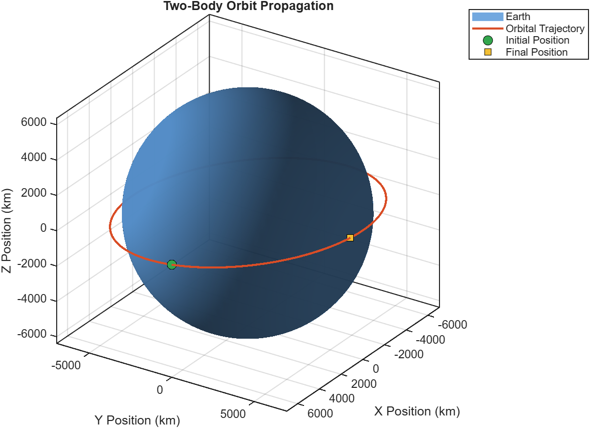

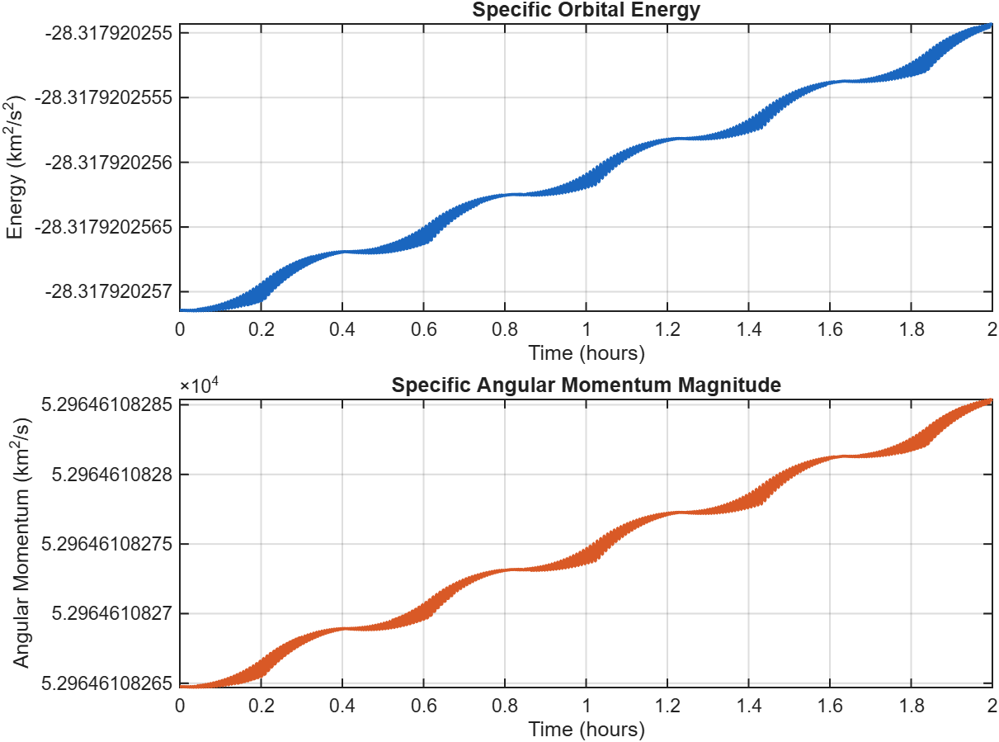

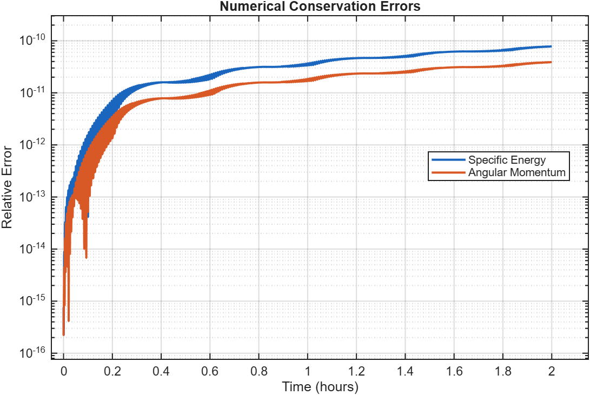

### Orbital elements

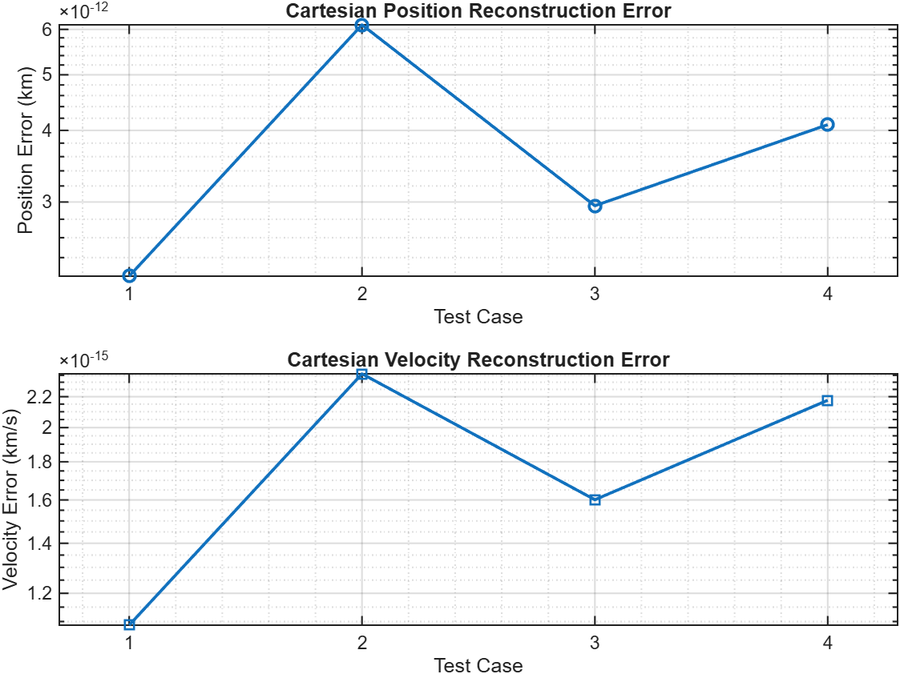

### Lambert transfer

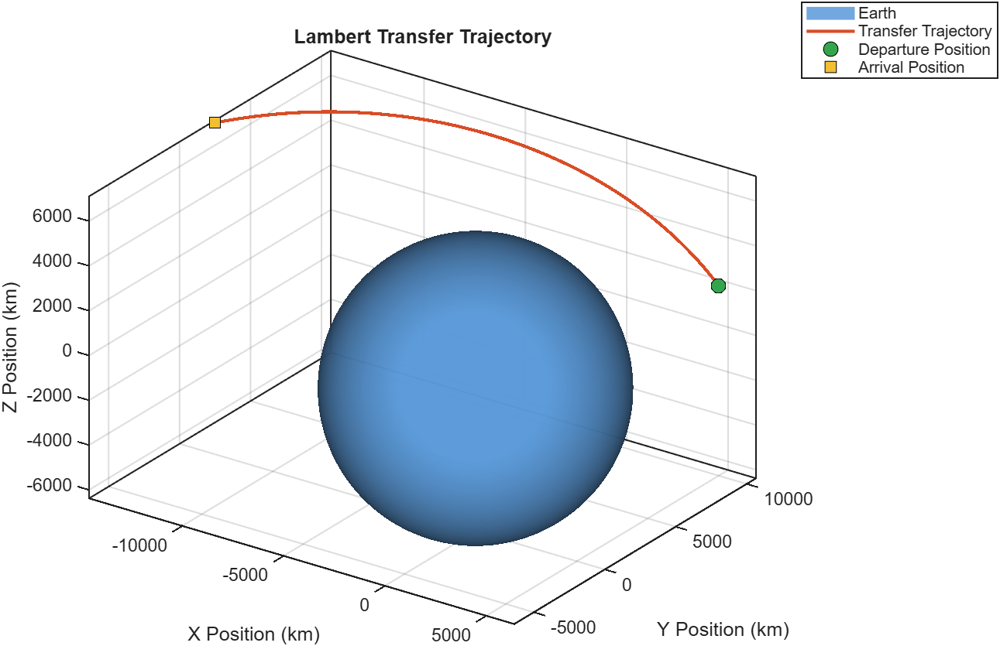

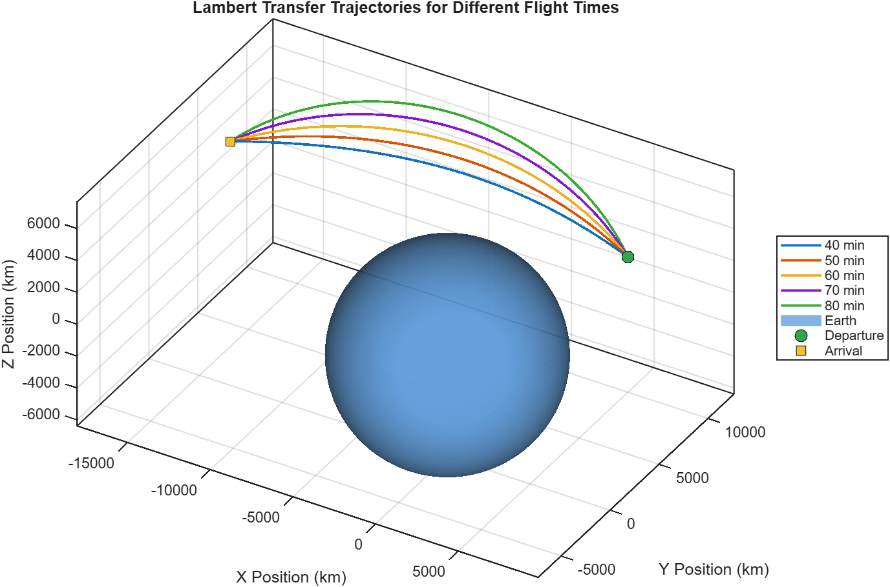

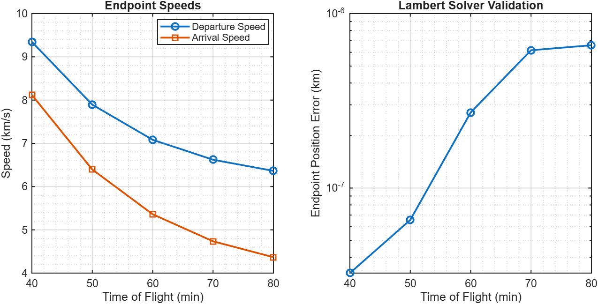

### Three-body dynamics

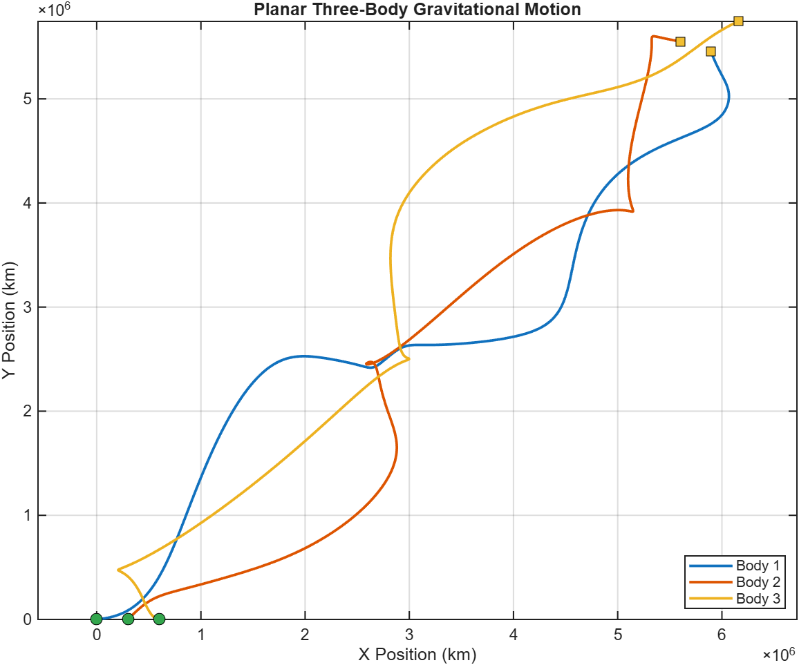

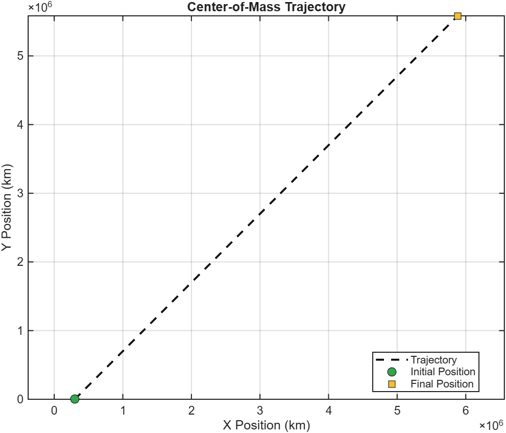

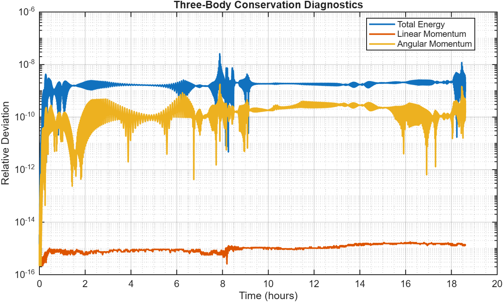

### Numerical accuracy

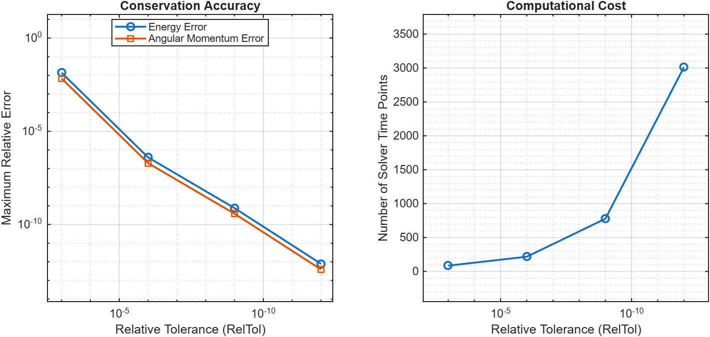

## Repository Structure

```text
.
├── src/
│   ├── propagate_two_body.m
│   ├── state_to_elements.m
│   ├── elements_to_state.m
│   ├── lambert_universal.m
│   └── three_body_rhs.m
├── examples/
├── tests/
├── figures/
├── tolerance_study_results.csv
├── lambert_time_study_results.csv
├── README.md
└── LICENSE
```

## Requirements

- MATLAB
- No additional toolboxes are intentionally required.

## Running the Examples

Open MATLAB with the repository as the current folder and run:

```matlab
addpath('src');

run('examples/example_orbit_propagation.m');
run('examples/example_orbital_elements.m');
run('examples/example_lambert_transfer.m');
run('examples/example_three_body.m');

run('examples/example_tolerance_study.m');
run('examples/example_elements_validation.m');
run('examples/example_elements_edge_cases.m');
run('examples/example_lambert_time_study.m');
```

The examples print numerical results and generate figures. The numerical study scripts also save CSV results in the repository root.

## Validation

The project includes checks for:

- Conservation of specific orbital energy and angular momentum during two-body propagation.
- Cartesian-to-orbital-elements-to-Cartesian round-trip accuracy.
- Circular, equatorial, and hyperbolic orbital-element cases.
- Lambert transfer endpoint accuracy.
- Energy, linear momentum, and angular momentum conservation in the three-body simulation.
- The relationship between solver tolerance, numerical error, and computational cost.

Run the available test scripts using:

```matlab
run('tests/test_orbital_elements.m');
run('tests/test_three_body.m');
```

## Conventions and Limitations

- Distances are in kilometres, time in seconds, and velocities in km/s unless stated otherwise.
- The gravitational parameter `mu` is in km³/s².
- Orbital elements are ordered as `[a, e, i, RAAN, argumentOfPeriapsis, trueAnomaly]`, with angles in radians.
- The Lambert solver is a single-revolution universal-variable implementation and does not cover every Lambert branch or multi-revolution transfer.
- The three-body model is planar and uses point masses with distances in km, time in seconds, masses in kg, and `G` in km³/(kg·s²).
- These are idealised gravitational models; perturbations and non-gravitational forces are not included.

## Reference

Curtis, Howard D. *Orbital Mechanics for Engineering Students*. The implementation is independently organised for educational and portfolio purposes, drawing on concepts from the textbook.
